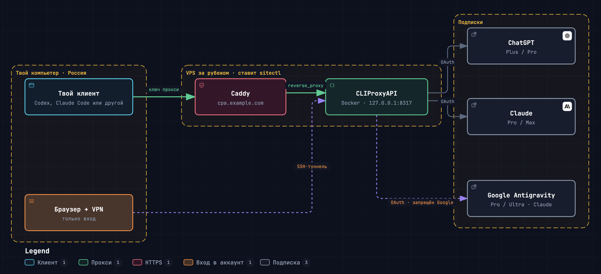

# Доступ к AI-сервисам

Подключи AI-модели через CLIProxyAPI и работай с ними в любимом кодинг-агенте.

- **Одна труба для моделей разных провайдеров.** Подключи доступные аккаунты и API к одному прокси и выбирай модели из общего списка в Pi, Claude Code или Codex.
- **Работа без VPN на рабочем компьютере.** Размести прокси на VPS с доступом к сервисам и подключайся к нему напрямую. Для регистрации, оплаты или входа в аккаунт доступность сети зависит от провайдера.

Руководство проведёт от подписки и настройки прокси до подключения клиента. Прокси также можно запустить локально.

> **Перед началом:** техническая совместимость не означает разрешение провайдера. Например, Google запрещает сторонний доступ к Antigravity, в том числе через OAuth; возможна блокировка аккаунта. Подробнее — [условия входа](docs/login.md). Проверь актуальные условия и доступность по странам до оплаты и подключения. Сторонний прокси получает доступ к учётным данным и запросам.

## Маршрут

1. [Регистрация и оплата](docs/accounts.md) — условия, ограничения и безопасность.
2. [Прокси на VPS](docs/vps.md) — сервер, HTTPS и ключи. Для локального запуска см. [альтернативу](docs/local.md).
3. [Вход в подписки](docs/login.md) — авторизация в прокси и ограничения провайдеров.
4. [Подключение клиентов](docs/clients.md) — Pi, Claude Code и Codex.
5. [Проверка и диагностика](docs/check.md) — проверка маршрута и типичных ошибок.

## Архитектура прокси

[Вход в подписку](https://shura-v.github.io/ai-access-guide/login.html) · [Маршрут запроса](https://shura-v.github.io/ai-access-guide/request.html)

Локальные HTML и JSON схем находятся в `docs/diagrams/`.
